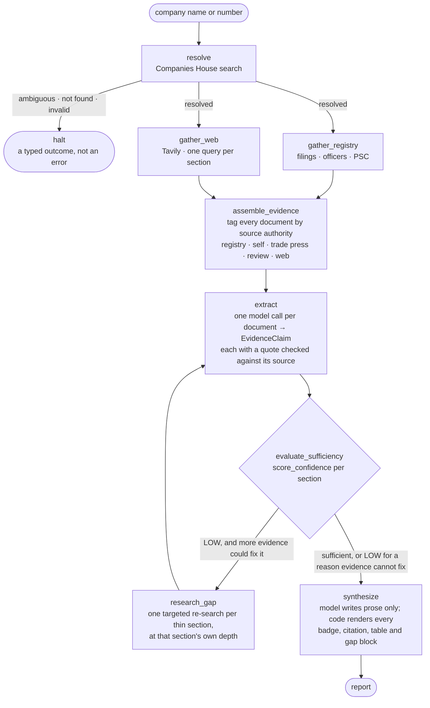

# groundwork

Agentic UK company underwriting intelligence: resolves a company, gathers evidence via Companies House + web, generates a citation-backed report with explicit per-section confidence.

---

## 1. What this is

If you underwrite a business you have never heard of, the first hour goes on the same questions every time: is this the company they mean, what does it actually do, who is it up against, and is there anything on the record that should worry me. Groundwork does that first pass. You give it a company name or registration number; it identifies the specific legal entity on the Companies House register, gathers what the register and the open web hold about it, and returns a short report covering the business model, the competitive landscape, and quality signals — every claim linked to the source it came from.

The part that matters more than the prose is the confidence rating. Each of the three sections carries its own band — HIGH, MEDIUM or LOW — produced by a stated rule rather than by asking a model how sure it feels, and the report shows the working: how many claims the band rests on, what kind of sources they came from, what evidence was missing, and where two sources disagreed. A section with thin evidence says so and looks visibly thinner. This is a first-pass triage tool that tells you how much to trust each part of itself; it is not a credit decision, and it is not a substitute for reading the filings.

## 2. What was built

**Company resolution with real disambiguation.** Typed input becomes one specific legal entity or a statable reason why not. Auto-resolution is deliberately hard to reach — it needs a unique exact name match on an active, non-dormant company. Everything else comes back as candidates to choose from, or as one company flagged for confirmation with the reasons attached (dissolved, dormant SIC code, matched on a former registered name, found only after relaxing the query). The reasons are a list, not a single value: a dissolved company found under a former name is both things at once.

**Evidence gathering that degrades honestly.** Companies House (profile, filing history, officers, persons with significant control) and a web search per report section, run concurrently. One source failing does not lose the others — it becomes a *recorded* gap that the report prints. Two failures are never degraded: a rejected API key raises rather than quietly reporting "no officers recorded" for every company, and a 404 on the PSC endpoint is a finding, because that is genuinely how the register answers "nobody is registered as controlling this company".

**Extraction where a citation cannot be fabricated.** Each document is processed on its own, and the model has no field through which a URL can arrive — the source is attached by code from the document the text came from. Every claim carries a verbatim quote that is checked against the source text; a quote that cannot be found costs the claim its score but never its place in the report. Claims from a document about a different legal entity (a US affiliate with a similar name) are marked non-scoring with the mismatch written into the claim text by code, not by asking the model nicely.

**Three report sections, each with its own confidence band** — business model, competitive landscape, quality signals — plus surfaced conflicts between sources, which are reported rather than resolved.

**Uncertainty as a mechanism, not a disclaimer.** The band comes from an explicit function (`src/report/confidence.py`) with defined precedence: a major conflict is checked before any claim count, a minor conflict caps a section at MEDIUM regardless of how many sources agree, and HIGH additionally requires a source with real authority — a company's own website only counts toward it if something independent corroborates it.

**An auditable decision log.** Every run records what the agent decided and *why*, including the times it decided to do nothing — a section that scored LOW but was not re-searched records that it was contradicted rather than thin, and that more evidence would not have helped.

## 3. Architecture overview

A LangGraph state machine over typed Python functions. FastAPI serves it, Streamlit consumes it, Cloud Run hosts it.



Two details in that graph are the point rather than decoration. The gather branches are **two real nodes**, so the concurrency and the per-source failure path are visible in the graph itself. And `extract → evaluate_sufficiency → research_gap → extract` is **a genuine cycle**, exited because a counter on the state says so — not because the edge back is missing.

**Layers.** `src/data_sources/` (register + search clients, source tagging, per-source circuit breakers) → `src/agent/` (resolution, the graph, extraction) → `src/report/` (confidence scoring, synthesis, rendering) → `src/api/` (gate, rate limits, endpoint). `src/llm/` sits beside them: one router and one circuit breaker that every model call in the codebase passes through, so no module talks to a provider SDK directly.

## 4. Key decisions

**The model writes prose; code renders every structural element.** Badges, citation numbering, source tables, conflict blocks, evidence-gap blocks and the working table are all assembled from data. Three things follow. A citation cannot be invented, because the model is never shown a URL. The confidence badge cannot drift from the score, because both print from the same assessment object. And the primary and fallback providers cannot produce differently-shaped reports — which was verified rather than assumed: run against the same evidence, Claude and Gemini produced *identical* structural signatures while their prose differed completely. *Rejected:* asking the model to emit the whole report in markdown, which makes every structural guarantee a matter of instruction-following that has to be re-earned each time a prompt changes.

**Confidence is a function, not a judgement call.** `score_confidence()` evaluates stated conditions in a fixed order. *Rejected:* asking the model for a confidence score — it produces a number that cannot be audited, cannot be tested, and drifts between model versions.

**The agent branches on a measured judgement, using the same function it publishes.** When a section scores LOW for a reason more evidence could fix, the agent generates a targeted follow-up query, validates mechanically that it is genuinely different and still names the company, and re-searches at that section's own depth. A *contradicted* section is deliberately not re-searched — that is LOW for a reason more evidence should not paper over. *Rejected:* re-searching on a fixed heuristic, which would drift from the band the report actually prints.

**The token gate and circuit breaker were built first, not last.** Every phase after the first was developed against real auth, real rate limits and real provider-fallback constraints rather than being exempted until the end. *Rejected:* the original plan, which scheduled both for the final phase.

**Parallel gathering is two real graph nodes, not one node calling `asyncio.gather`.** Identical wall-clock. The difference is that the concurrency and the per-source failure branch are visible in the graph, and the graph is a deliverable.

**Only a provider failure is an HTTP error.** A company that cannot be found, an ambiguous name, and a company with thin evidence are all `200`s carrying a typed outcome — they are findings, not client errors, and rendering disambiguation as a `4xx` would make the product's best behaviour look like a fault. `503` is reserved for "our model providers are down", which must never reach a reader wearing the same clothes as "this company is thinly documented".

**A quote that cannot be verified costs a claim its score, not its place.** Roughly one claim in five failed quote verification in live testing — concentrated in pages whose content arrives as a mangled table, where the figure is genuinely present but not as a contiguous span. Those claims still render, with the reason. *Rejected:* loosening the check to accept non-contiguous fragments, which would stop it catching the thing it exists to catch.

## 5. What was deliberately deferred, and why

**Rebrands and trading names (Phase 1.3).** These are two different things, and the system handles one of them. Both statements below were tested against the live Companies House API, not reasoned about.

**Former registered legal names — supported.** If a company changed its registered name, searching the old one finds it. Companies House indexes former names and flags them in the search response, and we confirm the match against the company's `previous_company_names` before surfacing it. Verified end to end: searching **"Focus FS"** returns **Monzo Bank Limited** (09446231, registered as FOCUS FS LIMITED from 2015-02-18 until 2016-10-21). The result is always presented for confirmation rather than resolved silently — a former name is evidence of identity, not proof of it.

**Trading and brand names that were never registered — not supported, and not fixable here.** If a name was only ever a brand, the register holds no record of it, so no matching logic can reach it. The tested example is the one most people would expect to work: **"Mondo" was Monzo's original brand**, dropped after a trademark dispute — but it was never the company's registered name (that went FOCUS FS LIMITED → MONZO BANK LIMITED). Searching "Mondo" returns **zero results for Monzo Bank Limited at any rank**, confirmed by sweeping the complete result set, not just the first page. The same applies to any brand-only name; Facebook → Meta fails identically.

The rebrand distinction matters because the two cases look the same to a user and have completely different causes. The first was an implementation question and is solved. The second is an absence of data at the source. We report "not found" honestly rather than guessing — an LLM asked to map a trading name to a legal entity was rejected as a fabrication surface at the one step where the register gives us ground truth, and a hand-maintained trading-name table was rejected as unbounded maintenance for arbitrary coverage.

**Conflict severity is judged by a model, and it misreads a specific case (Phase 4.3).** When two extracted claims disagree, the system classifies the disagreement MINOR or MAJOR against the definitions in the confidence rule, and a MAJOR sends that section's confidence to LOW. In the Phase 4 live run it called one disagreement MAJOR that was not one: *"40% of customers use Monzo as their main account"* versus *"49% of monthly active users use Monzo as a primary bank"*. Those are two different denominators — all customers versus monthly actives — so both can be true at once. A genuine MAJOR conflict means the sources contradict a core fact, and this is not that.

The consequence is real and one-directional: a false MAJOR **understates** confidence, taking a section to LOW when its evidence does not actually disagree. It cannot inflate a band. In that run it changed nothing, but only by luck — the second claim had already been excluded from scoring for an unrelated reason, and the rule only counts a conflict when every claim it references scores. The band was right for the wrong reason, which is not the same as the mechanism working.

**In the final deployment run it did move a band, so this is no longer hypothetical.** The competitive-landscape section scored LOW on three MAJOR conflicts, and all three are the same misreading in a different costume — a difference of *basis*, not a contradiction: a $5.2bn valuation against a $5bn Series I round; that Series I against a later employee secondary sale at just under $6bn; a $501m raise against a $600m one. Those are different instruments at different dates, and can all be true simultaneously. Unlike the earlier runs, every claim involved had scored, so the conflict counted and the section went to LOW.

That surfaced a second-order effect nobody predicted, worth stating because it cuts against the system's own design: the section had first scored LOW for *weak sources*, which triggered the agent's follow-up search; the extra evidence fixed the weak-sources problem (16 scored claims to 42) and introduced the false conflicts, so the section stayed LOW for the opposite reason. **More evidence lowered the confidence.** The direction is still safe — this understates rather than inflates, and both sides of every disagreement are printed for the reader to judge — but the adaptive re-search and the conflict classifier currently work against each other, and a fix to the classifier would pay off twice.

Not fixed, and named here rather than left in a build log: distinguishing "different denominators" from "contradictory figures" is a semantic judgement, and the cheap fixes considered — refusing conflicts between claims whose numbers have different units, or requiring two independent classification passes to agree — either miss most real conflicts or double the cost of every report. With more time this deserves a second classification pass with the disagreement's *basis* stated explicitly, so a denominator mismatch has somewhere to be declared. Both sides of every disagreement stay in the report regardless, since conflicts are surfaced rather than resolved.

**Register filing history inflates its own claim count (Phase 4.2).** Extraction is meant to turn a list of filings into the pattern across them — "accounts filed in each of the last six years" — plus any individually notable row. It does that for the officers document and does not for filing history, which comes back as one claim per row. The cause was isolated in live testing rather than guessed: the filing-history document renders the 100 most recent filings, and roughly 90 of those rows are opaque officer-appointment and termination codes. Given the same document with those rows removed, the same prompt returns exactly the three pattern claims intended. It is the volume of low-signal rows that drives the enumeration, not the instruction being ignored. The exposure is a thinly-documented company whose filing rows alone could clear the confidence rule's claim threshold; the fix belongs in how the register document is rendered, not in the extraction prompt.

**A filing's submission date can be reported as the period it covers (Phase 4.2, found in Phase 5).** A register filing row carries two dates, and in the Phase 5 live run one claim merged them: it read *"filed on 1 September 2025"* and reported *"full accounts for the year to 1 September 2025"*. The accounts in question cover a year ending in February; 1 September is when they were submitted. For an underwriter that is not a cosmetic slip — the period an account covers is what makes a figure current or stale, and a claim that names the wrong one states something its source does not support.

The mechanism is specific and worth naming, because it points at where the fix belongs. A filing row is rendered as `2025-09-01 — accounts — Full accounts made up to 2025-02-28`. **The leading date is the only unlabelled date anywhere in the register documents** — its meaning is positional convention, nothing more — while the period end sits inside the description as prose. Every other register date is labelled inline where it appears: officers read `appointed 2015-04-21` / `resigned 2026-01-14`, persons with significant control read `notified …` / `ceased …`, and the company profile reads `incorporated: …`. So the conflation risk is **not** general across Companies House metadata; it is localised to the filing-history document — but *within* that document it is systematic rather than a one-off, since every accounts and confirmation-statement row has the same two-date shape.

That makes filing history the source of two of the four limitations named here, and both have the same root: how the document is rendered rather than how the prompt is written. The extraction prompt already demonstrates the correct handling in its own worked example — *"most recently full accounts for the year to 28 February 2025, filed on 1 September 2025"* — and the model still merged the two on real data, which is the same pattern as the enumeration problem above: a stated instruction that does not survive the document's shape. Not fixed under this timeline. Labelling the filed date where it is rendered is a small change, but it is a change to what an evidence document contains, which is a decision the data-gathering layer owns.

One related absence, stated so it is not mistaken for the same bug: the register's *next accounts due* date is not rendered into any document at all, so the system cannot make a claim about filing deadlines even though the register holds one. That is missing evidence, not wrong evidence.

**Web evidence can be attributed to a different company with a similar name (Phase 2.3, found in Phase 7.1).** Resolution pins the subject to one legal entity on the register, and that works. Evidence gathering does not re-verify identity to the same standard, and a specific case defeats the guard that exists for it.

Found by running a deliberately thin-evidence company end to end: ASHGROVE BESPOKE CABINETRY LTD (16259703), registered office in **Tonbridge, Kent**. The web search returned at least three different UK businesses — a cabinetmaker in **Glasgow**, a joinery firm in **Devon**, and a site stating **East Sussex** — and extraction attributed all of them to the subject company.

**No entity warning fired, and the reason is structural rather than a tuning miss.** The system already flags documents that name a different entity — it was built after a Better Business Bureau page for *Monzo, Inc.* (the US company) reached a UK report. That check keys on the subject's distinctive name tokens, and every one of these sources shares the token "Ashgrove". The other half of that fix, anchoring every query to the UK, does not help when all three confusable businesses genuinely are UK companies.

**The property that makes this matter: it is correlated with thin evidence.** A well-documented company dominates its own search results. A small company with a generic-sounding name does not, so the ranking fills with same-named others. The failure mode is worst exactly where an underwriter most needs the report to be careful.

**What contained it, stated because it is the honest half of the finding.** The report did not present the conflated facts confidently. It surfaced the contradiction, printed both locations, and said the evidence did not allow either to be confirmed — the section reads *"Both are reported here without preference… this conflict is a primary reason the evidence in this section supports only a low-confidence account of the business."* The uncertainty mechanism bounded a grounding failure it was not designed to catch. That is reassuring about the architecture and is not a reason to leave the defect: the attribution is still wrong.

Not fixed under this timeline. The fix is to require identity corroboration — a matching registered office, company number or officer name — before a web document may contribute *scoring* claims, leaving uncorroborated ones in the prose as non-scoring. That is a change to the data-gathering layer, the same layer and the same decision the two filing-history limitations above are already waiting on.

**One thing this run also showed about the limitation above it.** The same thin company drew 11 scored register claims almost entirely from enumeration — enough to clear the confidence rule's HIGH threshold with an `official_registry` source present. It reported LOW only because the conflated-entity contradictions tripped the conflict check first. Two defects cancelled, which is precisely how a problem ships looking correct. Full analysis in `docs/phase-7.1-run-results.md`.

**A section's write-up can fail without the report failing.** If a synthesis call returns nothing usable, that section still renders its real band, sources, gaps and conflicts from data, and says plainly that the *written summary* is what is missing rather than the evidence — the two must never look alike. A total provider failure is a different case and halts the run with a `503`. This is designed behaviour with tests over it, not an error state, and you may see it on the live demo. It happened once on **the same deployed run described above** — the one whose competitive-landscape section scored LOW on three misread conflicts — where Section 3's prose is absent while its HIGH band, 8 sources and evidence gaps all render normally. Worth knowing that we only found that by looking: the reason a section failed is currently written to the server log and not returned in the response, so that run reported `outcome: complete` with no indication a section had degraded ([`DESIGN_NOTE.md`](DESIGN_NOTE.md) §4 covers why those warnings are unsurfaced).

**Deferred features, named rather than quietly dropped.** Deeper register analysis (SIC-code changes over time, officer turnover rate, filing punctuality) was scoped as a stretch item and not built — the underlying PSC and filing data is already gathered, tagged and in the evidence bundle, so this is unbuilt analysis rather than missing data. Progress streaming on `/report` was considered and rejected: the decision log delivers what a progress bar would, and delivers it auditably after the fact. Multi-instance-safe rate limiting is not implemented (see §7).

## 6. Setup

```bash
git clone https://github.com/SourabhaKK/groundwork.git
cd groundwork

cp .env.example .env      # then fill in the five required keys
uv sync --dev

uv run pytest             # tests — no live API calls, everything mocked
uv run ruff check .       # lint

uv run uvicorn src.api.main:app --reload    # API on http://127.0.0.1:8000
uv run streamlit run frontend/app.py        # frontend
```

Five keys are required: Companies House, Tavily, Anthropic, Google (Gemini), and the demo access token. The app validates configuration at startup and **fails immediately** if any is missing — or if any is still a placeholder. That second check exists because it was learned the hard way: a placeholder key starts cleanly and then fails on every outbound call, surfacing as *a report with no evidence in it*, which is indistinguishable from an honest report about a thinly documented company. That is the one signal this system must never fake.

The frontend reads `GROUNDWORK_API_URL` and `GROUNDWORK_TOKEN` from the environment if set, and otherwise takes both in the sidebar. It defaults to the hosted API, so it works against the live demo without configuration.

## 7. How to use it

Enter a company name or registration number. `Monzo Bank Ltd` and `09446231` both resolve to the same entity — leading zeros are optional, since people type `9446231`.

The report comes back as three sections, each opening with a confidence badge that states the band, why it was reached, and how many claims it rests on, followed by prose with numbered citations, a source table, any conflicts, and any evidence gaps. Below it, the frontend shows the agent's decision log and the full claim list including the claims that did *not* score, with the reason each was excluded.

### The two behaviours worth testing deliberately

**Disambiguation.** Try `Monzo` (no legal suffix) or `Focus FS`. The first is not a unique exact match; the second matches a *former registered name*. Both return candidates rather than a report, with the reasons attached — selecting one re-submits by registration number. For the honest failure case, try `Mondo`: it returns nothing, because that brand was never a registered name and the register holds no record to match (§5).

**Low confidence.** Pick any small, recently-incorporated company with no press coverage — a random active company from the register works. Its report should be visibly thinner: LOW bands, few claims, evidence gaps stated explicitly. If a thin company and a well-documented one look similarly confident, the uncertainty mechanism is not working, and that comparison is the fastest way to check it.

**Invalid input.** `!!!` is rejected before any network call — it contains no
alphanumerics, so it cannot be a company name. Note the honest boundary here: a
20-digit number like `12345678901234567890` is *not* rejected up front. It
passes validation, fails the company-number pattern, and is searched as a name,
returning **not found**. That is a correct and honest outcome, but it costs a
register call — pre-flight validation only catches input that cannot possibly be
a company, not input that merely is not one.

### Access token

`/report` is gated by a shared bearer token, provided separately and deliberately not stored in this repository. See the submission communication for the current value, or contact the repo owner. The token is held in Secret Manager and injected at runtime; no credential is committed here or baked into the container image.

Send it as an `Authorization` header:

```bash
curl -X POST https://groundwork-213351312105.europe-west2.run.app/report \
  -H "Authorization: Bearer <token>" \
  -H "Content-Type: application/json" \
  -d '{"query": "Monzo Bank Ltd"}'
```

A missing or wrong token returns `401` before any rate-limit budget is consumed.

`/health` needs no token and reports operational state (breaker, budget, search-quota status).

### Rate limits, and why they exist

The hosted demo runs on a personal API key and a metered search tier, so `/report` is capped:

| Limit | Value | Reason |
|---|---|---|
| Per client | 5 reports/hour | Comfortably more than testing every scenario above back to back |
| Global | 80 reports total | Worked back from the search provider's 1,000-credit monthly free tier at the real worst-case per-report cost — 5 credits for the baseline gather, up to 10 if all three sections need a follow-up search — reserving 200 credits for development and manual end-to-end runs |

Exceeding either returns `429` with an explanatory message rather than a bare failure.

**Known limitation, stated plainly:** both counters live in the API process. They reset if the container is replaced, and if the service ever scaled beyond one instance each would keep its own counters. Deployment pins `--max-instances=2` to bound the second case. The durable ceiling is upstream regardless — the search free tier stops on its own, and provider-side spend limits cap the rest. This limiter is a courteous speed bump, not a budget guarantee, and is documented as such rather than presented as airtight.

## 8. Hosted demo

**https://groundwork-213351312105.europe-west2.run.app**

Google Cloud Run, `europe-west2` (London), in a GCP project dedicated to this submission. Secrets come from Secret Manager via a least-privilege runtime service account; nothing is baked into the image, which runs as a non-root user.

**Cold starts — measured, not estimated.** The service scales to zero. The numbers below come from one real request issued as the *first* traffic after the container had been idle past its scale-to-zero window, so they are what an evaluator's first request actually costs — not a warm-path timing:

| | |
|---|---|
| **Cold first request, end to end** | **85.3s** (`POST /report`, "Monzo Bank Ltd", HTTP 200) |
| ├ container cold start | ~13s |
| └ agent run | ~72s |
| Warm `/health` | 0.09s |

So the cold container adds roughly **13 seconds** — the agent run itself is the bulk of the wait, and that cost is there warm or cold. A keep-warm ping (`.github/workflows/keep-warm.yml`) hits `/health` every 10 minutes to hold a container up, which removes the 13s but not the 72s.

**The ping is a mitigation, not a guarantee, and it is worth saying why.** GitHub's scheduled workflows are best-effort and are routinely delayed past their cron time under platform load, and they are disabled automatically after 60 days of repository inactivity. If the ping has lapsed when you arrive, expect the 85s figure rather than ~72s. Cloud Scheduler would be more reliable and free at this volume; it was not adopted because it means another API and another IAM binding for a ~13s improvement on a number that is disclosed here either way.

Requests are allowed up to 600s server-side, so a slow run has room without the platform cutting it off mid-report.

---

## 9. Design note

**[`DESIGN_NOTE.md`](DESIGN_NOTE.md)** — what the system does and why it is trustworthy, the architecture, the key decisions with their rejected alternatives, what was deferred, and what would change with more time. Start there if you are reading one document rather than the repo.

---

## Project documents

| Document | What it holds |
|---|---|
| [`DESIGN_NOTE.md`](DESIGN_NOTE.md) | The system design note — product, architecture, decisions, deferrals, next steps |
| [`PRD.md`](PRD.md) | The problem being solved and its scope |
| [`TECH_STACK.md`](TECH_STACK.md) | Every tool choice with the alternatives rejected and why |
| [`TASKS.md`](TASKS.md) | The phased build plan, ticked as delivered |
| [`BUILD_LOG.md`](BUILD_LOG.md) | What *actually* happened per phase, including what broke and what was measured wrong. Past entries are never edited — corrections are appended, so the log stays an honest record rather than a cleaned-up story |
| [`workflows.md`](workflows.md) | The process the build followed, and the pre-build plan audits |
| [`docs/phase-7.1-run-results.md`](docs/phase-7.1-run-results.md) | The four end-to-end validation runs, the structural diff, and the independent quality rubric scored against each |
| [`docs/phase-7.3-self-audit.md`](docs/phase-7.3-self-audit.md) | Self-audit against the brief's six evaluation dimensions, each cited to code |
| `AGENTS.md` / `CLAUDE.md` | Repo conventions and boundaries |

**On how this was built.** Claude Code was used as the implementation tool throughout. The process in `workflows.md` required every non-trivial decision to be stated with its reasoning and its rejected alternative, and confirmed, before any code was written — and `BUILD_LOG.md` records what each phase actually produced, including the assumptions that live testing broke. Both files are in the repo rather than summarised here, so the judgement behind the code can be read directly rather than taken on trust.
